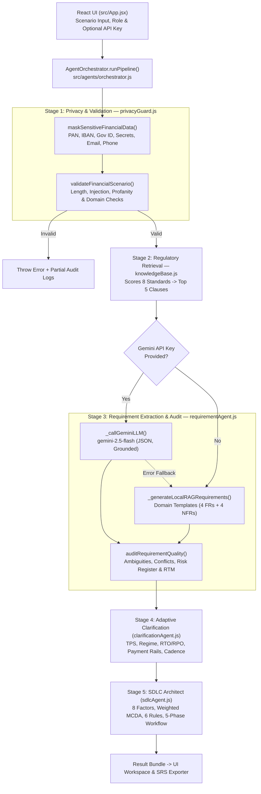
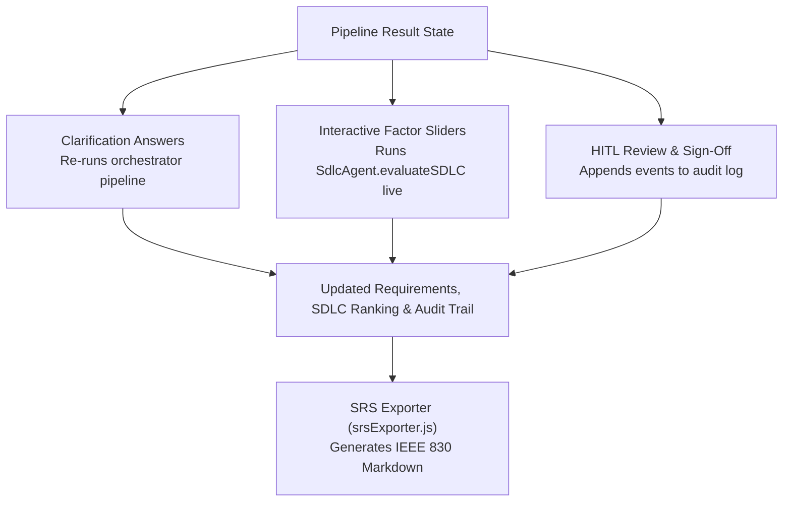

# System Architecture — FinReq AI

Technical architecture, data flows, scoring formulas, and module responsibilities for FinReq AI.

**Domain:** Banking, FinTech, and Capital Markets Software Engineering  
**Referenced Standards:** IEEE 830, ISO/IEC 25010, PCI-DSS v4.0, RBI CSF & DLG 2023, GDPR, Basel III / BCBS 239, SOX 404, ISO 20022, SEBI / SEC Cir. 2023/88

---

## 1. End-to-End Pipeline

Every analysis runs through `AgentOrchestrator.runPipeline(rawScenarioText, options)` in `src/agents/orchestrator.js`:



---

## 2. Interactive Feedback Loops

Once the initial pipeline completes, three client-side loops run without requiring a backend:



---

## 3. Stage Breakdown

### Stage 1: Privacy Guardrail & Validation (`src/agents/privacyGuard.js`)

Runs before any downstream agent or external LLM request.

#### Redaction Rules (`maskSensitiveFinancialData`)

| PII / PCI Category | Replacement Token | Detection Scope |
|---|---|---|
| Primary Account Number | `[REDACTED_PCI_PAN]` | 13-19 digit card numbers (Visa, MC, Discover, Amex, JCB, RuPay) and grouped 4-digit card patterns |
| Bank Account / IBAN | `[REDACTED_BANK_ACCOUNT]` | IBAN strings (`[A-Z]{2}[0-9]{2}...`) and prefixed account numbers (`ACC`/`ACCT`/`ACCOUNT`) |
| Government ID | `[REDACTED_GOV_ID]` | 12-digit Aadhaar groups, US SSN (`NNN-NN-NNNN`), Indian PAN tax format (`AAAAA9999A`) |
| API Secret / Credential | `[REDACTED_API_SECRET]` | AWS access keys (`AKIA...`), Stripe live keys (`sk_live_...`), GitHub PATs (`ghp_...`), Bearer tokens |
| Email Address | `[REDACTED_PII_EMAIL]` | Standard email regex |
| Phone Number | `[REDACTED_PII_PHONE]` | 10-digit Indian mobile numbers (with optional country code) and 10-digit hyphen/dot/space formats |

#### Input Validation (`validateFinancialScenario`)

1. Rejects non-string/empty inputs and inputs shorter than 15 characters.
2. Blocks 5 prompt-injection patterns (`ignore previous instructions`, `reveal system prompt`, `disregard prior rules`, `bypass security/compliance/guardrails`, `jailbreak`).
3. Rejects profanity and inputs with fewer than 4 alphanumeric tokens.
4. Requires at least one token matching a curated set of financial/software terms (`bank`, `payment`, `pci`, `rbi`, `basel`, `rtgs`, `ledger`, `trading`, etc.).

---

### Stage 2: Regulatory Retrieval (`src/agents/knowledgeBase.js`)

`retrieveFinancialContext(queryText, clarificationAnswers, topK = 5)` merges the masked scenario and clarification answers, tokenizes to lowercase words, and scores each entry in `FINANCIAL_KNOWLEDGE_BASE` (8 entries):

- **Keyword scoring:** For each keyword in an entry's `keywords` list, adds `+2` if `keyword.length > 4`, else `+1` when found in tokens or substring text.
- **Baseline weight:** Entries `KB-PCIDSS-01` and `KB-RBI-CSF-01` receive a baseline `+2` boost so baseline payment security and banking compliance are surfaced when relevant.
- **Confidence formula:** `min(0.98, 0.70 + min(rawScore, 15) * 0.02)`.
- Returns the top 5 entries with `rawScore > 0`, sorted descending.

Also exports `STAKEHOLDER_ROLES` (6 personas: `ciso`, `compliance`, `architect`, `cro`, `product`, `audit`).

---

### Stage 3: Requirements & Quality Engineer (`src/agents/requirementAgent.js`)

#### Extraction Modes

- **Local Mode (`_generateLocalRAGRequirements`):** Detects sub-domain keywords (`hasRTGS`, `hasAlgoTrading`, `hasWealth`, `hasLending`, `hasAuditSOX`, `hasCoreBanking`) and synthesizes 4 domain-tailored Functional Requirements (`FR-FIN-01` to `FR-FIN-04`) and 4 quantified Non-Functional Requirements (`NFR-FIN-01` to `NFR-FIN-04`).
- **Live LLM Mode (`_callGeminiLLM`):** Invoked when an API key longer than 10 characters is provided. Sends the masked scenario, stakeholder focus, clarification answers, and the top 5 RAG clauses to `gemini-2.5-flash` (`temperature: 0.2`, `responseMimeType: 'application/json'`). Any HTTP or JSON parsing failure falls back cleanly to Local Mode and logs a warning.

#### Requirement Object Shape

```json
{
  "id": "FR-FIN-01",
  "title": "Primary Account Number (PAN) Encryption & FIPS 140-2 Level 3 HSM Tokenization",
  "category": "Cardholder Data Security & Key Management",
  "multiLabels": ["Functional", "Security", "Regulatory"],
  "priority": "Critical",
  "riskLevel": "Critical",
  "sourceStakeholder": "Chief Information Security Officer (CISO) & Security Lead",
  "statement": "The system shall ...",
  "userStory": "As a CISO, I want ...",
  "acceptanceCriteria": ["..."],
  "businessJustification": "...",
  "applicableRegulations": ["PCI-DSS v4.0 Req 3.4 & 3.5", "RBI Cyber Security Framework Annex 1"],
  "citations": ["KB-PCIDSS-01", "KB-RBI-CSF-01"],
  "confidence": 0.97
}
```

#### Quality Audit, Risk Register & RTM

- `auditRequirementQuality()` scans for 6 ambiguous terms (`fast`, `user-friendly`, `seamless`, `secure`, `real-time`, `scalable`), skipping terms that already have explicit quantifiers (such as `ms`, `tps`, `aes`, `tls`) in the scenario.
- Checks 3 financial conflict patterns:
  - `CONF-FIN-01`: 1-click/frictionless checkout vs. 2FA/SCA/PCI mandates.
  - `CONF-FIN-02`: Sub-second/instant settlement vs. deep AML/sanctions screening.
  - `CONF-FIN-03`: Rapid/agile release cadence vs. statutory SOX/PCI/RBI/Basel audit gates.
- Computes quality score: `clamp(96 - ambiguities * 4 - conflicts * 3, 68, 97)`.
- Produces a 4-item Risk Register (`RISK-FIN-01` through `RISK-FIN-04`) and maps every FR/NFR into an IEEE 830 Requirements Traceability Matrix (`traceabilityMatrix`).

---

### Stage 4: Adaptive Clarification (`src/agents/clarificationAgent.js`)

`ClarificationAgent.generateClarifications(scenarioText, stakeholderRole)` inspects the scenario text and conditionally raises up to 5 questions for constraints not yet stated:

1. `transaction_volume`: Peak TPS & latency tier (skipped if `tps`, `transactions per second`, `volume`, or `concurrent` is present).
2. `regulatory_regime`: Governing framework (skipped if `pci`, `rbi`, `basel`, `gdpr`, or `sox` is present).
3. `financial_dr`: Disaster recovery RTO/RPO targets (skipped if `rto`, `rpo`, `zero data loss`, or `failover` is present).
4. `interoperability`: Payment rail / clearing protocol (skipped if `iso 20022`, `swift`, `upi`, `ach`, or `core banking` is present).
5. `release_cadence`: Change frequency & audit gate governance (always asked, tailored to the selected `stakeholderRole`).

---

### Stage 5: SDLC Architect (`src/agents/sdlcAgent.js`)

#### 8-Factor Extraction (`_extractFactors`)

Extracts baseline scores (`0-100`, clamped) from scenario text + clarification answers, overridden by any keys passed in `customFactors`:

- `requirementStability` (base `54`)
- `changeFrequency` (base `52`)
- `regulatoryCriticality` (base `50`)
- `securityRisk` (base `55`)
- `technicalUncertainty` (base `30`)
- `failureConsequence` (base `55`)
- `continuousDeploymentNeed` (base `45`)
- `formalVerificationNeed` (base `45`)

#### Weighted MCDA Formulas (`_performMCDA`)

Using shorthand `stab`, `chg`, `reg`, `sec`, `unc`, `fail`, `deploy`, `verif`:

- **Waterfall:** `0.38*stab + 0.22*verif + 0.25*(100 - chg) + 0.15*(100 - unc)`
- **V-Model:** `0.38*verif + 0.22*fail + 0.18*reg + 0.12*stab + 0.10*(100 - chg)`
- **Spiral Model:** `0.44*unc + 0.24*fail + 0.16*(100 - stab) + 0.16*chg`
- **Agile (Scrum):** `0.42*chg + 0.26*(100 - stab) + 0.20*deploy + 0.12*(100 - verif)` (minus `16` penalty when `reg > 78 || sec > 80`)
- **DevSecOps:** `0.38*deploy + 0.32*sec + 0.18*chg + 0.12*(100 - stab)`
- **Agile-DevSecOps Hybrid:** `0.28*reg + 0.24*sec + 0.22*chg + 0.14*deploy + 0.12*verif`

#### 6 Deterministic Override Rules

Checked in priority order. When `customFactors._fromSlider === true`, text-phrase triggers are disabled so users tuning sliders see purely quantitative rule transitions:

1. **Waterfall:** Text contains `"stable requirements"` and `"approvals"` (auto mode), or `stab >= 82 && chg <= 28 && verif >= 65 && fail < 90` -> forces `waterfallScore = 96`.
2. **V-Model:** Text contains `"strict verification"` or `"verification/validation"` (auto mode), or `verif >= 88 && fail >= 85 && unc < 70 && chg <= 40` -> forces `vModelScore = 96`.
3. **Spiral Model:** Text contains `"high uncertainty"` or `"technical risk"` (auto mode), or `unc >= 78` -> forces `spiralScore = 96`.
4. **Agile-DevSecOps Hybrid:** Text contains (`"high regulation"` or `"regulated"`) and (`"evolving"` or `"changing"`) (auto mode), or `reg >= 80 && chg >= 58 && verif >= 70` -> forces `hybridScore = 96`.
5. **DevSecOps:** Text contains `"continuous secure deployment"` (auto mode), or `deploy >= 85 && sec >= 80 && reg < 90 && verif < 85` -> forces `devSecOpsScore = 96`.
6. **Agile (Scrum):** Text contains `"frequently changing"` without `"regulation"` or `"secure deployment"` (auto mode), or `chg >= 72 && reg < 75 && sec < 78` -> forces `agileScore = 95`.

#### 5-Phase Workflow (`_generateFinancialWorkflow`)

Generates a 5-phase delivery roadmap (Inception & Scoping -> Architecture & Threat Modeling -> Secure Implementation -> Formal V&V & Penetration Testing -> Production & Chained Audit Ledger) with duration estimates adapted to the winning SDLC model, roles, deliverables, security controls, and entry/exit criteria.

---

### Stage 6: Governance & SRS Export (`src/App.jsx`, `src/utils/srsExporter.js`)

`generateSRSMarkdown()` produces a downloadable/copyable Markdown document containing 8 sections:

1. Introduction, Scope, and Retrieved Regulatory Sources
2. Functional Requirements (with approval status, user story, acceptance criteria, citations)
3. Non-Functional Requirements (with target metrics and approval status)
4. Quality, Ambiguity & Conflict Audit
5. Financial Risk Register & IEEE 830 RTM
6. SDLC Selection, MCDA Ranking & 8 Factor Scores
7. 5-Phase Financial Workflow
8. HITL Sign-Off Record & Timestamped Agent Execution Audit Log

---

## 4. File Inventory

| File | Role |
|---|---|
| `index.html` | HTML entry point and Google Fonts setup (`IBM Plex Sans`, `IBM Plex Mono`) |
| `public/favicon.svg` | Shield-and-currency SVG logo mark used as favicon and README icon |
| `vite.config.js` | Vite React build and dev server config (`port: 3000`) |
| `src/main.jsx` | React 19 root mount |
| `src/App.jsx` | Workbench UI: role/API controls, preset & file input, collapsible clarifications, tabbed requirements/audit/RTM view with status filters and batch approval, live MCDA sliders, expandable workflow timeline, sign-off, collapsible audit log, and SRS export |
| `src/index.css` | Light-blue/white CSS custom properties, typography rules, panel layout, tables, sliders, and timeline styles |
| `src/agents/orchestrator.js` | `AgentOrchestrator` class coordinating Stages 1-5 and logging |
| `src/agents/privacyGuard.js` | `maskSensitiveFinancialData` and `validateFinancialScenario` |
| `src/agents/knowledgeBase.js` | `STAKEHOLDER_ROLES`, `FINANCIAL_KNOWLEDGE_BASE`, `retrieveFinancialContext` |
| `src/agents/requirementAgent.js` | `RequirementAgent` and `auditRequirementQuality` |
| `src/agents/clarificationAgent.js` | `ClarificationAgent` gap analysis |
| `src/agents/sdlcAgent.js` | `SdlcAgent` factor extraction, MCDA, rules, and 5-phase workflow |
| `src/agents/presets.js` | `FINANCIAL_PRESETS` (5) and `FINANCIAL_SDLC_EXAMPLES` (6) |
| `src/utils/srsExporter.js` | `generateSRSMarkdown` |
| `test_agents.mjs` | Node.js verification test suite using `node:assert/strict` |
