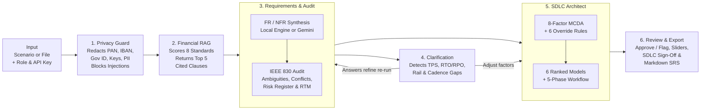

# FinReq AI

Requirements engineering, regulatory compliance mapping, and SDLC selection platform for financial services, banking, and fintech software projects.

## What It Does

Software teams in banking and fintech have to reconcile fast product delivery with statutory controls such as PCI-DSS v4.0, RBI Cyber Security Framework, Basel III / BCBS 239, SOX 404, GDPR, and ISO 20022. FinReq AI processes a plain-text system description or policy document through a sequence of browser-side modules and produces:

- **Sanitized input** with credit card numbers, bank accounts, government IDs, emails, phone numbers, and API credentials masked prior to inference.
- **IEEE 830 requirements** (functional and non-functional) mapped to versioned regulatory clauses with confidence scores, acceptance criteria, and a Requirements Traceability Matrix (RTM).
- **Quality and conflict audit** flagging vague terms (such as unquantified "fast" or "scalable") and common domain tensions (such as 1-click checkout vs. mandatory 2FA/SCA).
- **Clarification prompts** covering peak TPS, regulatory jurisdiction, disaster recovery (RTO/RPO), payment rails, and release cadence.
- **SDLC ranking and 5-phase workflow** evaluating 6 lifecycle models across 8 project factors and 6 deterministic rules, with interactive factor sliders for sensitivity analysis.
- **Human-in-the-loop review and Markdown SRS export** with per-requirement Approve/Flag tracking, SDLC sign-off, and an execution audit trail.

---

## Processing Flow



---

## Core Modules

| Module | File | Responsibility |
|---|---|---|
| Pipeline Coordinator | [`src/agents/orchestrator.js`](src/agents/orchestrator.js) | Runs stages sequentially, handles validation failures, and records timestamped audit log events. |
| Privacy Guardrail | [`src/agents/privacyGuard.js`](src/agents/privacyGuard.js) | Masks 6 PII/PCI token types via regex and rejects inputs under 15 chars, under 4 words, prompt injections, profanity, or non-financial text. |
| Regulatory Knowledge Base | [`src/agents/knowledgeBase.js`](src/agents/knowledgeBase.js) | Holds 6 stakeholder profiles and 8 versioned regulatory entries; scores and retrieves top matching citations. |
| Requirement Engineer | [`src/agents/requirementAgent.js`](src/agents/requirementAgent.js) | Generates domain-specific FRs/NFRs locally or via `gemini-2.5-flash` (with automatic local fallback), audits vague terms and conflicts, and builds the Risk Register and RTM. |
| Clarification Agent | [`src/agents/clarificationAgent.js`](src/agents/clarificationAgent.js) | Surfaces targeted questions for missing operational constraints (peak TPS, regulatory regime, RTO/RPO, payment rails, release cadence). |
| SDLC Architect | [`src/agents/sdlcAgent.js`](src/agents/sdlcAgent.js) | Extracts 8 quantitative factors (`0-100`), evaluates 6 SDLC models via weighted MCDA + 6 deterministic rules, and builds a 5-phase workflow. |
| Presets | [`src/agents/presets.js`](src/agents/presets.js) | 5 financial case studies and 6 rule verification scenarios. |
| SRS Exporter | [`src/utils/srsExporter.js`](src/utils/srsExporter.js) | Generates an 8-section IEEE 830 Markdown document containing requirements, approvals, RTM, risk register, SDLC ranking, workflow, and audit log. |

---

## Regulatory Coverage

`src/agents/knowledgeBase.js` grounds generated requirements against 8 built-in standards:

| ID | Standard | Clauses / Scope | Jurisdiction |
|---|---|---|---|
| `KB-PCIDSS-01` | PCI-DSS v4.0 | Req 3.4, 3.5, 4.2 (AES-256-GCM, HSM key management, no CVV storage) | Global Card Industry |
| `KB-RBI-CSF-01` | RBI CSF & Digital Lending Guidelines | Annex 1 & DLG Sec. 4-6 (fraud monitoring, domestic data localization, direct disbursement) | India (RBI) |
| `KB-GDPR-01` | GDPR | Articles 17, 25, 32 (consent, erasure with statutory AML retention overrides) | European Union / Cross-border |
| `KB-BASEL-01` | Basel III / BCBS 239 | Principles 2, 3, 6 (intraday LCR/NSFR, risk data aggregation, stress testing) | BIS / Global Central Banks |
| `KB-SOX-01` | Sarbanes-Oxley Act | Section 404 (segregation of duties, dual approval, immutable ledger trails) | US SEC |
| `KB-ISO20022-01` | ISO 20022 Messaging | `pacs.008`, `camt.053` (schema validation, idempotency, UETR tracking) | SWIFT / Global Clearing |
| `KB-SEBI-01` | SEBI / SEC Algo Risk | Cir. 2023/88 (sub-ms pre-trade risk checks, IEEE 1588 PTP clock sync, drop-copy feeds) | SEBI / SEC / FINRA |
| `KB-ISO25010-01` | ISO/IEC 25010 | Clauses 4.2, 4.3 (99.999% uptime, active-active failover, RPO = 0, RTO < 30s) | International Baseline |

---

## SDLC Selection Logic

`SdlcAgent` evaluates 8 factors (each scored `0-100`):

1. Requirement Stability (`requirementStability`)
2. Change Frequency (`changeFrequency`)
3. Regulatory Criticality (`regulatoryCriticality`)
4. Security & PCI/PII Risk (`securityRisk`)
5. Technical Uncertainty (`technicalUncertainty`)
6. Financial Failure Impact (`failureConsequence`)
7. Continuous Deployment Need (`continuousDeploymentNeed`)
8. Formal Verification & Audit (`formalVerificationNeed`)

### Deterministic Override Rules

Before relying solely on weighted MCDA scores, `_performMCDA()` checks 6 precedence-ordered rules (text keyword triggers are skipped when adjusting sliders manually so interactive tuning works predictably):

| Priority | Trigger Condition | Selected SDLC Model |
|---|---|---|
| 1 | Keyword match (`stable requirements` + `approvals`) or `stability >= 82`, `changeFreq <= 28`, `formalVerif >= 65`, `failureImpact < 90` | Waterfall |
| 2 | Keyword match (`strict verification` or `verification/validation`) or `formalVerif >= 88`, `failureImpact >= 85`, `uncertainty < 70`, `changeFreq <= 40` | V-Model |
| 3 | Keyword match (`high uncertainty` or `technical risk`) or `uncertainty >= 78` | Spiral Model |
| 4 | Keyword match (`high regulation`/`regulated` + `evolving`/`changing`) or `regulatory >= 80`, `changeFreq >= 58`, `formalVerif >= 70` | Agile-DevSecOps Hybrid |
| 5 | Keyword match (`continuous secure deployment`) or `continuousDeploy >= 85`, `security >= 80`, `regulatory < 90`, `formalVerif < 85` | DevSecOps |
| 6 | Keyword match (`frequently changing` without regulation/secure deploy) or `changeFreq >= 72`, `regulatory < 75`, `security < 78` | Agile (Scrum) |

---

## Built-in Case Studies

| Preset | Category | Default Stakeholder |
|---|---|---|
| Multi-Channel Core Banking & Real-Time Payment Gateway | Core Banking / Payment Rails | CISO |
| Central Bank RTGS & High-Assurance Liquidity Engine | Interbank Settlement / High-Assurance | Enterprise Architect |
| High-Frequency Algorithmic Trading & AI Fraud Surveillance | Capital Markets / AI Risk | Chief Risk Officer |
| Retail Wealth Management & Digital Investment Advisory | WealthTech / Consumer FinTech | Product Lead |
| Cloud-Native Payment Switch & Card Tokenization Platform | Payment Infrastructure / Cloud-Native | CISO |

---

## Getting Started

### Prerequisites

- Node.js 18+
- npm

### Install & Run

```bash
npm install
npm run dev
```

Vite is configured in `vite.config.js` to serve on `http://localhost:3000/`.

### Build for Production

```bash
npm run build
```

### Run Verification Tests

```bash
npm test
```

Runs `node test_agents.mjs`, verifying PCI/PII masking, prompt-injection blocking, quality/conflict auditing, RAG citation grounding, all 6 SDLC override rules, and IEEE 830 Markdown export.

### Optional Live Gemini Mode

By default, FinReq AI runs offline using the built-in rule and knowledge-base engine. To use live `gemini-2.5-flash` extraction grounded in the retrieved regulatory context, click **Optional Gemini API Key** in the UI and enter a Gemini API key (stored only in React component state for the active session). If the API call fails, the agent falls back to the local engine and logs a warning in the audit trail.

---

## Project Structure

```text
finreq-ai/
├── index.html
├── package.json
├── vite.config.js
├── README.md
├── ARCHITECTURE.md
├── test_agents.mjs
├── public/
│   └── favicon.svg
└── src/
    ├── main.jsx
    ├── App.jsx
    ├── index.css
    ├── agents/
    │   ├── orchestrator.js
    │   ├── privacyGuard.js
    │   ├── knowledgeBase.js
    │   ├── requirementAgent.js
    │   ├── clarificationAgent.js
    │   ├── sdlcAgent.js
    │   └── presets.js
    └── utils/
        └── srsExporter.js
```

For module internals, scoring formulas, and data structures, see [ARCHITECTURE.md](ARCHITECTURE.md).
